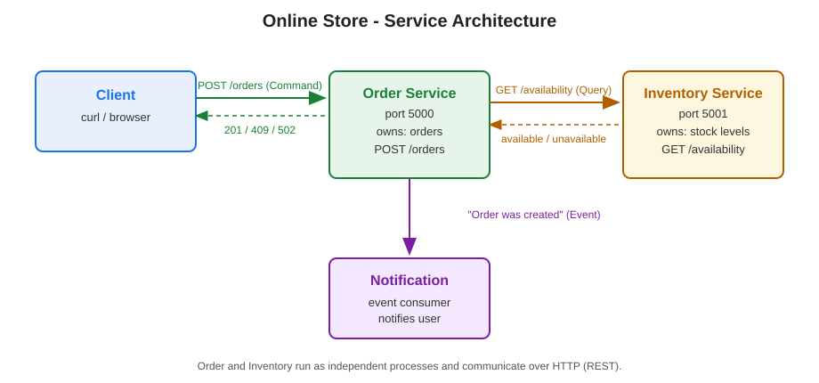
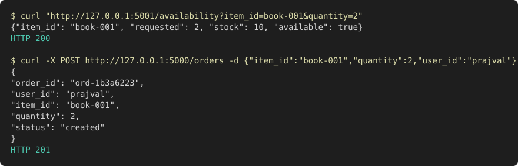
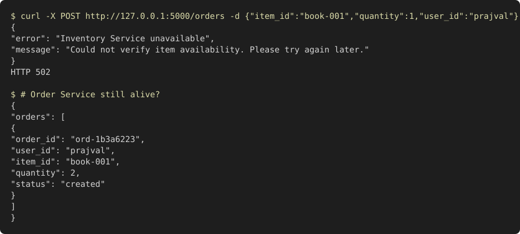
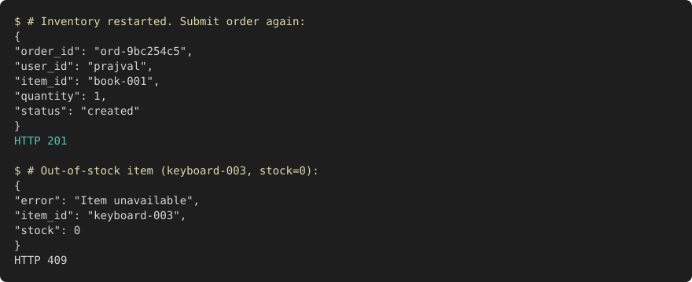

# Distributed Online Store

A small distributed application with three responsibilities: **Order** (creates and tracks orders), **Inventory** (tracks item availability), and **Notification** (notifies users when an order is created).

## Architecture



### Component responsibilities

- **Order Service** (`order_service.py`, port 5000) — accepts order submissions, checks availability with the Inventory Service, creates and stores orders, and emits the "Order was created" event.
- **Inventory Service** (`inventory_service.py`, port 5001) — answers availability queries from its in-memory stock data.
- **Notification** (`notification.py`) — consumes the "Order was created" event and notifies the user. Implemented as a small module called by the Order Service; in a full system it would be an independent event subscriber.

### Data ownership

- **Order Service** owns order records (`order_id`, `user_id`, `item_id`, `quantity`, `status`). It never modifies stock directly.
- **Inventory Service** owns stock levels per item. It is the only component that can answer availability questions.

### Why these service boundaries

Availability checking and order tracking change for different reasons and at different rates: stock levels change constantly, while order history is append-only. Splitting them means the Inventory Service can be scaled or replaced (e.g. with a real warehouse system) without touching order logic, and each service fails independently — an inventory outage does not take down order history.

## Command, Query, and Event

| Interaction | Type | Why |
|---|---|---|
| Check whether an item is available | **Query** | It only reads state and returns data; it changes nothing. |
| Create an order | **Command** | It requests a state change (a new order record). |
| Order was created | **Event** | It is a fact about something that already happened; subscribers (Notification) react to it asynchronously. |

## Running the services

No third-party dependencies — Python standard library only (Python 3.8+).

```bash
pip install -r requirements.txt   # nothing to install, stdlib only

# Terminal 1 - Inventory Service
python3 inventory_service.py

# Terminal 2 - Order Service (separate, independent process)
python3 order_service.py
```

## Example: successful request

```
$ curl -X POST http://127.0.0.1:5000/orders \
    -H 'Content-Type: application/json' \
    -d '{"item_id":"book-001","quantity":2,"user_id":"prajval"}'

{
  "order_id": "ord-1b3a6223",
  "user_id": "prajval",
  "item_id": "book-001",
  "quantity": 2,
  "status": "created"
}
HTTP 201
```

Order flow: `POST /orders` -> Order Service calls `GET /availability` on the Inventory Service -> item available -> order created -> "Order was created" event triggers the user notification (logged in `notifications.log`).



Requesting an out-of-stock item (`keyboard-003`, stock 0) returns `409 {"error": "Item unavailable"}`.

## Failure test: Inventory Service stopped

With the Inventory Service stopped, submitting an order gives:



The Order Service catches the connection failure, returns `502 {"error": "Inventory Service unavailable"}`, logs the error, and keeps running — `GET /orders` still works afterward. After restarting the Inventory Service, orders succeed again (`201`), proving the Order Service never crashed:



## Reflection

Clear service boundaries and data ownership matter because they limit the blast radius of failures and changes. When only the Inventory Service owns stock data, no other service can corrupt it, and an inventory outage degrades to a clear error instead of crashing the whole store. Boundaries also let each service evolve independently — the inventory backend can be rewritten or scaled without touching order logic. In a distributed system where components fail independently, knowing exactly who owns what data is what keeps the system understandable and recoverable.
